<h1 align="center">Orbit</h1>

<p align="center">
  A team of AI agents you chat with, each with its own screen on its own computer.<br>
  <a href="https://github.com/NousResearch/hermes-agent">Hermes Agent</a> runs the bots, a Docker desktop gives each one a screen, <a href="https://composio.dev">Composio</a> connects their apps, and local STT/TTS, a GPU (audio.cpp, with a lip-synced avatar) or xAI gives them a voice.
</p>

<p align="center">
  <a href="https://raybello.github.io/orbit/">Website</a> ·
  <a href="https://raybello.github.io/orbit/#download">Download</a> ·
  <a href="https://raybello.github.io/orbit/docs/">Docs</a> ·
  <a href="#what-you-get">What you get</a> ·
  <a href="#how-it-fits-together">How it works</a> ·
  <a href="#build-and-run">Build and run</a> ·
  <a href="#build-per-target">Build per target</a> ·
  <a href="#run-the-docker-stack">Docker</a> ·
  <a href="#gpu-voice-from-a-checkout">GPU voice</a> ·
  <a href="#models-and-subscriptions">Models</a> ·
  <a href="#status-and-limits">Limits</a>
</p>

<p align="center">
  <a href="https://github.com/raybello/orbit/actions/workflows/ci.yml"></a>
  <a href="https://github.com/raybello/orbit/actions/workflows/publish-images.yml"></a>
  <a href="https://raybello.github.io/orbit/"></a>
  <a href="https://github.com/raybello/orbit/stargazers"></a>
  <a href="https://github.com/raybello/orbit/commits/main"></a>
  <a href="https://github.com/raybello/orbit/issues"></a>
  <a href="https://github.com/raybello/orbit/pulls"></a>
  <br>
  <a href="LICENSE"></a>
  
  
  
  
  
</p>

<p align="center">
  <a href="https://raybello.github.io/orbit/">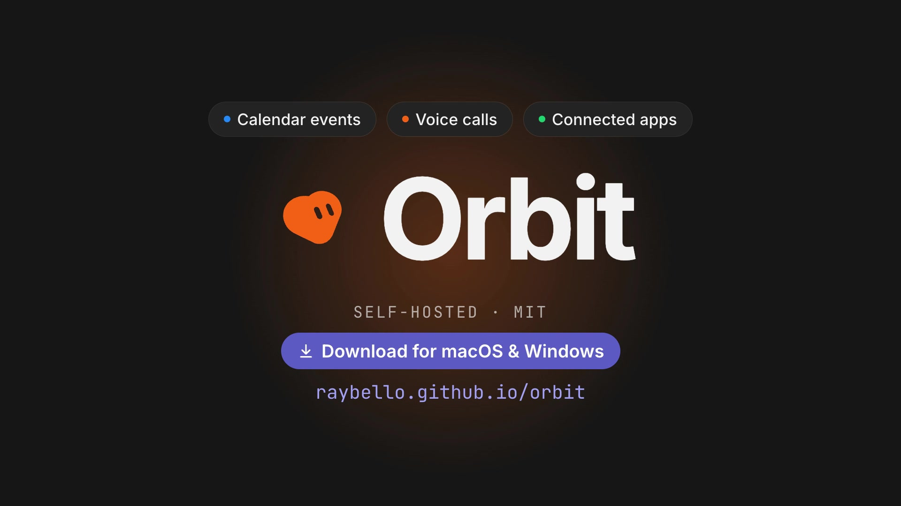</a><br>
  <sub><a href="https://raybello.github.io/orbit/">Watch the 22-second launch video</a> · <a href="site/media/brag.mp4">16:9 MP4</a> · <a href="site/media/brag-vertical.mp4">9:16 MP4</a></sub>
</p>

<p align="center">
  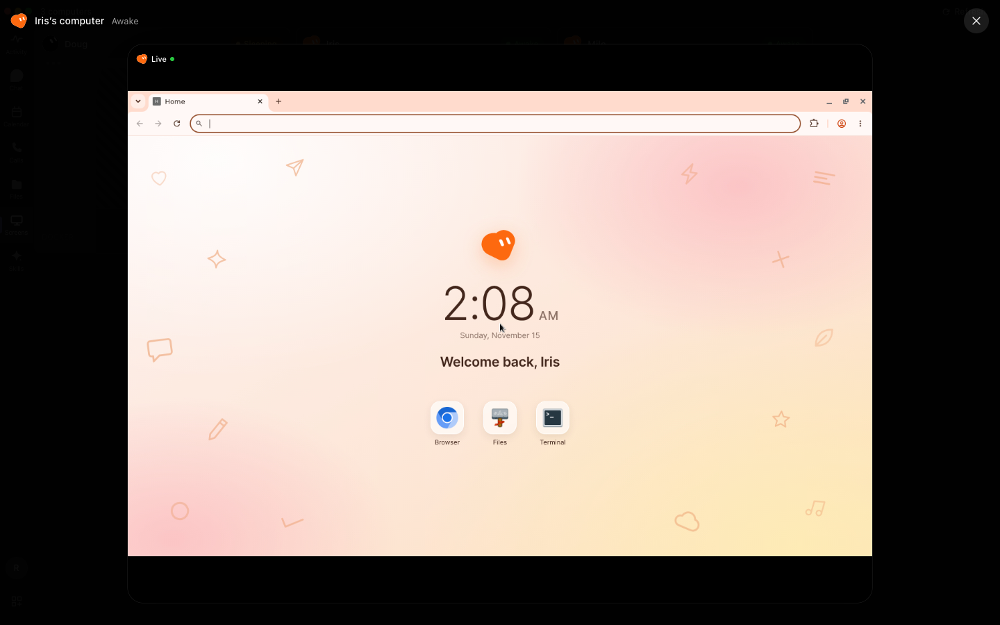
</p>

Give a bot a job, connect the apps it needs, and follow its work in chat. Each bot has a name, a look, its own memory, a Hermes engine, and a Docker desktop you can watch or take over. Bots can message each other in groups, run one-time and recurring calendar events, and talk with you over voice.

The interface is modeled on Grok Bot. Underneath, every bot is a Hermes agent, so it can run on the model subscriptions you already pay for (Claude, ChatGPT, Grok and others) or on API keys.

All screenshots below were captured from this branch while the flows were exercised against a live server. The desktop app hosts the same renderer as the web app; the mobile shots are from an iPhone 17 Pro simulator.

## What you get

| | |
|---|---|
| **Chat that shows the work** | While a bot works you see what it is doing right now, how long it has been at it, and each step it took. Finished turns fold into a "Worked for 1m 14s · 2 steps" chip you can open. |
| **A screen per bot** | Every bot gets its own Docker desktop with Xvfb, Chrome and a VNC relay. Watch it live, open it full size, or take control with your own mouse and keyboard. |
| **Create a bot in one dialog** | Name it, pick a shape and colour, choose personal or teammate. The bot gets a Hermes home, an engine, a screen and its own memory. |
| **Group chats with bot handoffs** | A group is a room with members. A message dispatches the bots it @mentions, or the whole room (capped at three). A bot can @mention a peer and Orbit dispatches that peer one hop deeper. |
| **Calendar events, once or recurring** | Create a one-time event at a date and time, or a recurring event on a cron preset (daily, weekdays, weekly) or a custom expression. The assigned bot runs the prompt when it fires. |
| **Voice calls** | Talk to a bot from the composer. Orbit prefers on-device STT/TTS when the model cache is present, degrades to the cloud voice when it is not, and puts the spoken turn into the bot's normal transcript. |
| **GPU voice with a talking avatar** | On Windows and Linux with an NVIDIA GPU, install the audio.cpp sidecar from the bot's Voice settings and calls run on your GPU: OWSM speech recognition, LFM3-Audio speech in 38 voices, and SoulX-FlashHead animating a portrait you upload, lip-synced to the reply. Replies are spoken a sentence at a time while the model is still writing. macOS uses on-device voice. See [docs/voice-audiocpp.md](docs/voice-audiocpp.md). |
| **Model and subscription per bot** | Pick the provider and model in the bot's Engine panel, or sign in to a subscription on the bot's own screen. |
| **Connected apps with approvals** | Bots ask for the app they need and you connect it through Composio. Actions that write (send, post, delete) wait for your OK on a card in the chat. |
| **Routines, tasks and a Library** | Recurring jobs on a schedule, a task list per bot, and a place where bots save the files they make. |
| **Mobile app** | An Expo client for iOS and Android: chats, threads, calendar, files, computers and a live VNC viewer. Point it at any Orbit server, or bake the URL into a build. |

<table>
  <tr>
    <td width="50%">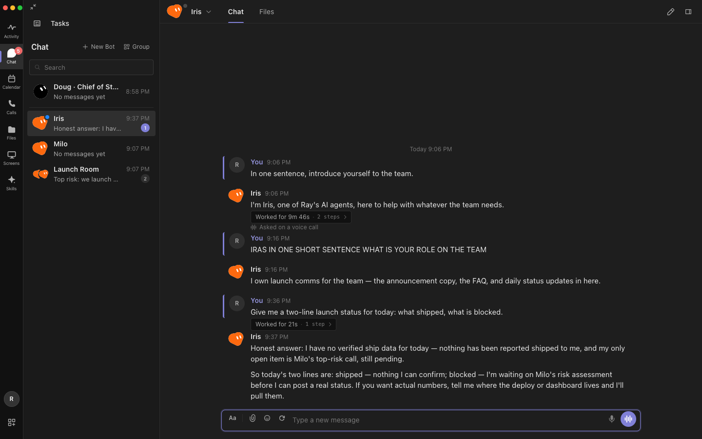</td>
    <td width="50%">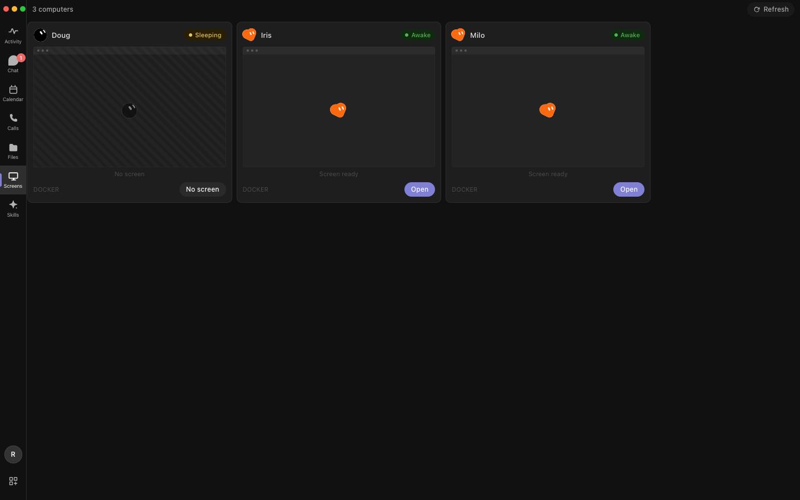</td>
  </tr>
  <tr>
    <td align="center"><sub>Chat: the bot answers in its own transcript</sub></td>
    <td align="center"><sub>Screens: one desktop per bot</sub></td>
  </tr>
</table>

### Creating, grouping and handing off

<table>
  <tr>
    <td width="50%">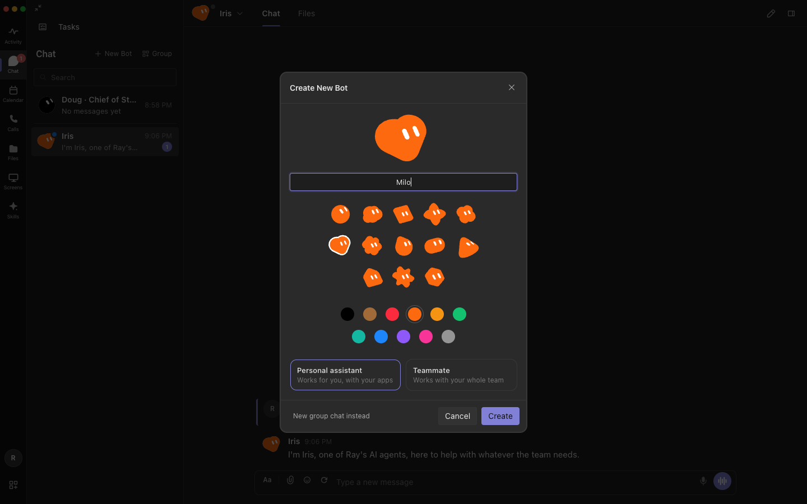</td>
    <td width="50%">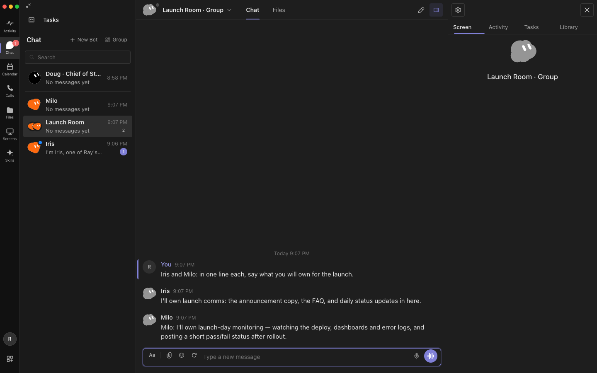</td>
  </tr>
  <tr>
    <td align="center"><sub>Creating a bot: name, avatar, mode</sub></td>
    <td align="center"><sub>Group chat: both bots answer the room</sub></td>
  </tr>
  <tr>
    <td>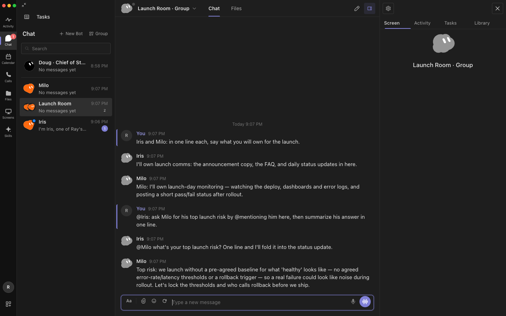</td>
    <td>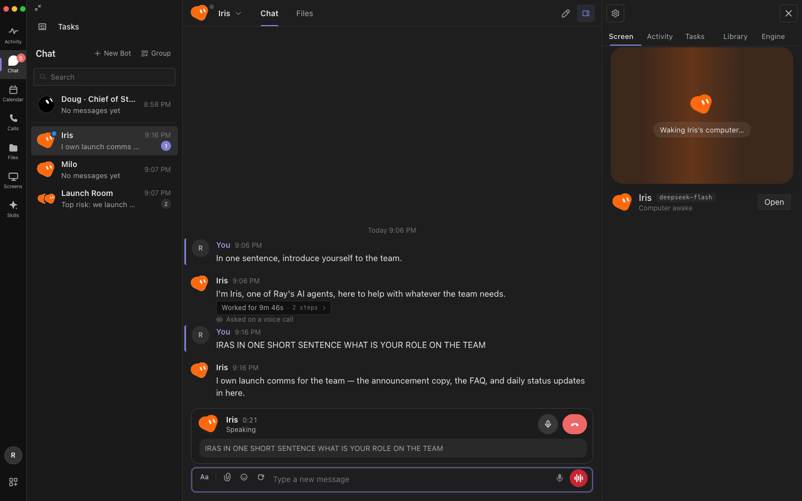</td>
  </tr>
  <tr>
    <td align="center"><sub>Inter-bot handoff: Iris asks Milo, Milo replies</sub></td>
    <td align="center"><sub>Voice call: speech in, transcript and reply out</sub></td>
  </tr>
</table>

### GPU voice calls with an animated avatar

<table>
  <tr>
    <td width="50%">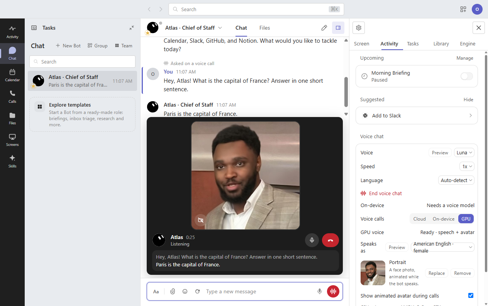</td>
    <td width="50%">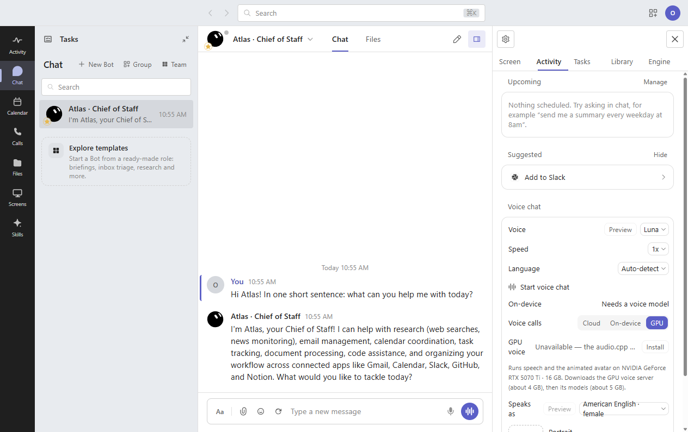</td>
  </tr>
  <tr>
    <td align="center"><sub>A call on the GPU: the portrait speaks the agent's answer</sub></td>
    <td align="center"><sub>Opt-in: Install names the GPU and the download first</sub></td>
  </tr>
</table>

### Calendar

<table>
  <tr>
    <td width="50%">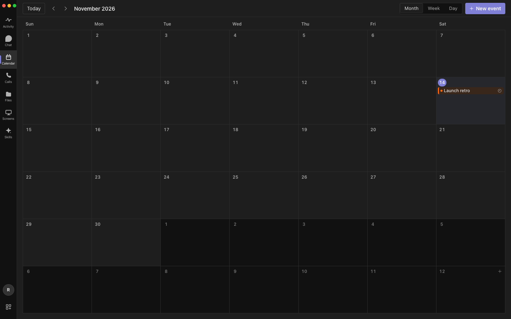</td>
    <td width="50%">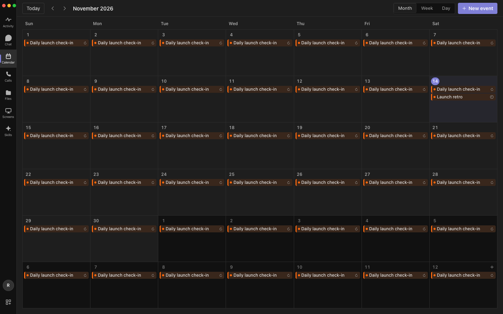</td>
  </tr>
  <tr>
    <td align="center"><sub>One-time event</sub></td>
    <td align="center"><sub>Recurring daily event, plus the one-time event</sub></td>
  </tr>
</table>

### On mobile

<table>
  <tr>
    <td width="25%">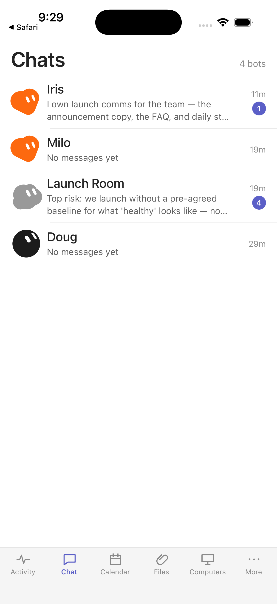</td>
    <td width="25%">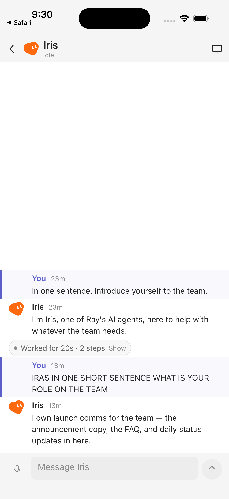</td>
    <td width="25%">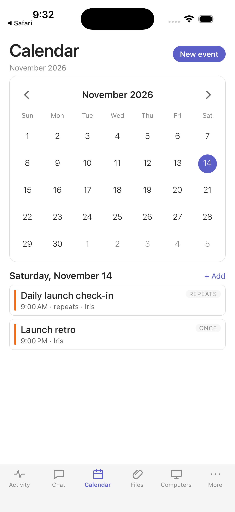</td>
    <td width="25%">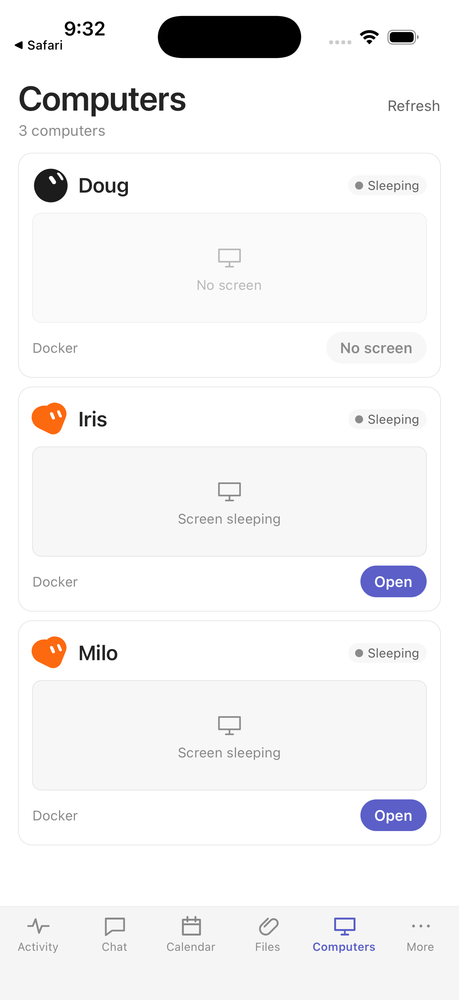</td>
  </tr>
  <tr>
    <td align="center"><sub>Chats</sub></td>
    <td align="center"><sub>Thread</sub></td>
    <td align="center"><sub>Calendar</sub></td>
    <td align="center"><sub>Computers</sub></td>
  </tr>
</table>

## How it fits together

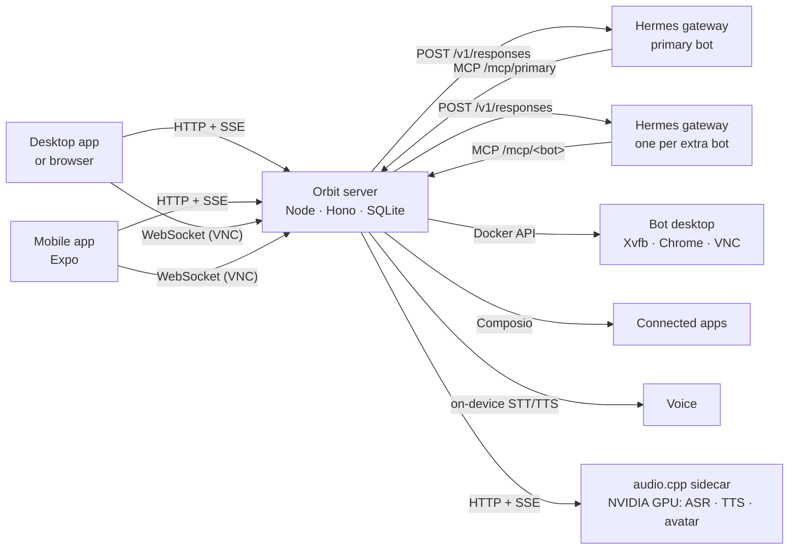

- **One bot, one Hermes home.** The first bot is the Hermes agent already running on the machine. Each further bot gets `ENGINES_DIR/<botId>` and its own `hermes gateway run`.
- **One bot, one desktop.** With `COMPUTER_KIND=docker` (the default) each bot gets a Linux container running Xvfb, fluxbox, Chrome and `x0vncserver`. The server relays VNC over a WebSocket, so the browser and the phone see the same screen. `COMPUTER_KIND=orgo` uses Orgo screens instead.
- **The app's tools reach Hermes over MCP.** The server exposes `/mcp/<bot>`. Each agent gets connected apps, tasks, routines, the Library, computer tools and messages to other bots.
- **Groups are rooms, not agents.** A room row has `kind='room'` and a member list. The server dispatches turns; the bots reply with `post_to_group`, and an @mention triggers the next hop.
- **The server owns the transcript.** Chat rows, cards, routines and screens live in SQLite. SSE fans changes out to every connected client, desktop and mobile.

More detail is in the [documentation site](https://raybello.github.io/orbit/docs/) (usage, setup, [API reference](https://raybello.github.io/orbit/docs/api.html), [source map](https://raybello.github.io/orbit/docs/source.html)), the [architecture guide](docs/ARCHITECTURE.md) and [per-bot computers](docs/per-bot-computers.md).

### How this relates to Hermes Bot Mode

Hermes Desktop has its own Bot Mode. Orbit uses the same Hermes engine but does **not** use Bot Mode: it has its own bot layer on top of the gateway's HTTP API.

| | Orbit | Hermes Bot Mode |
|---|---|---|
| A bot is | A separate Hermes home (the first bot is the default profile) | A Hermes profile |
| Gateways | One per extra bot | One, serving every profile |
| Transport | HTTP, `/v1/responses` | JSON-RPC over WebSocket |
| Routines | The app's own scheduler | Hermes cron jobs |
| Bot to bot | Group rooms and `send_to_bot` | Hermes' `message_agent` tool |

So bots made here do not show up in Hermes Desktop's Bots tab, and bots made there do not show up here.

## Install the desktop app

Download the installer for your computer from the [website](https://raybello.github.io/orbit/#download) (it picks your platform and shows each file's size and SHA-256) or from [GitHub Releases](https://github.com/raybello/orbit/releases/latest).

| Platform | File |
|---|---|
| macOS, Apple silicon | `Orbit-<version>-arm64.dmg` |
| macOS, Intel | `Orbit-<version>.dmg` |
| Windows | `Orbit-Setup-<version>.exe` |
| Linux | `Orbit-<version>.AppImage` |

The builds are not signed with an Apple or Microsoft certificate yet, so the first launch needs one extra step.

### macOS

1. Open the DMG and drag **Orbit** into **Applications**.

   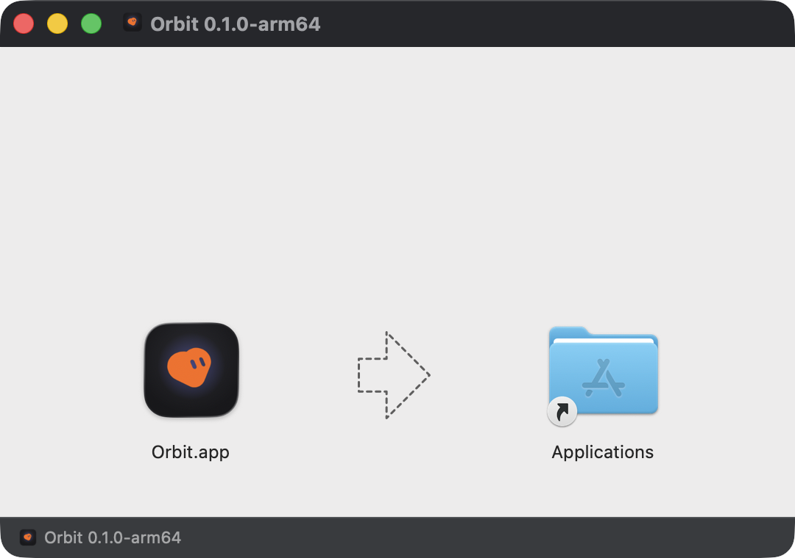

2. Open Orbit from Applications. Because the app is not notarized yet, macOS stops the first launch with "Orbit.app Not Opened". Click **Done**.

   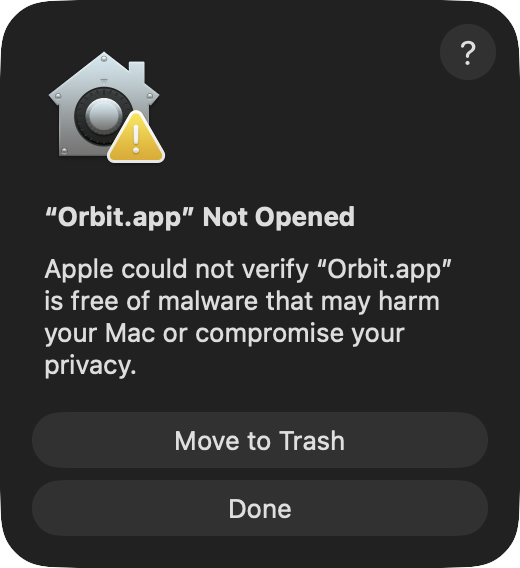

3. Allow it once, either way:
   - **Terminal:** clear the download flag, then open Orbit again.

     ```bash
     xattr -dr com.apple.quarantine /Applications/Orbit.app
     ```

   - **System Settings:** go to **Privacy & Security**, scroll to **Security**, and click **Open Anyway** next to the Orbit message (macOS shows it right after a blocked launch from Finder).

4. Choose where Orbit runs. **This computer** runs the server locally; **Existing instance** connects to a server you already run.

   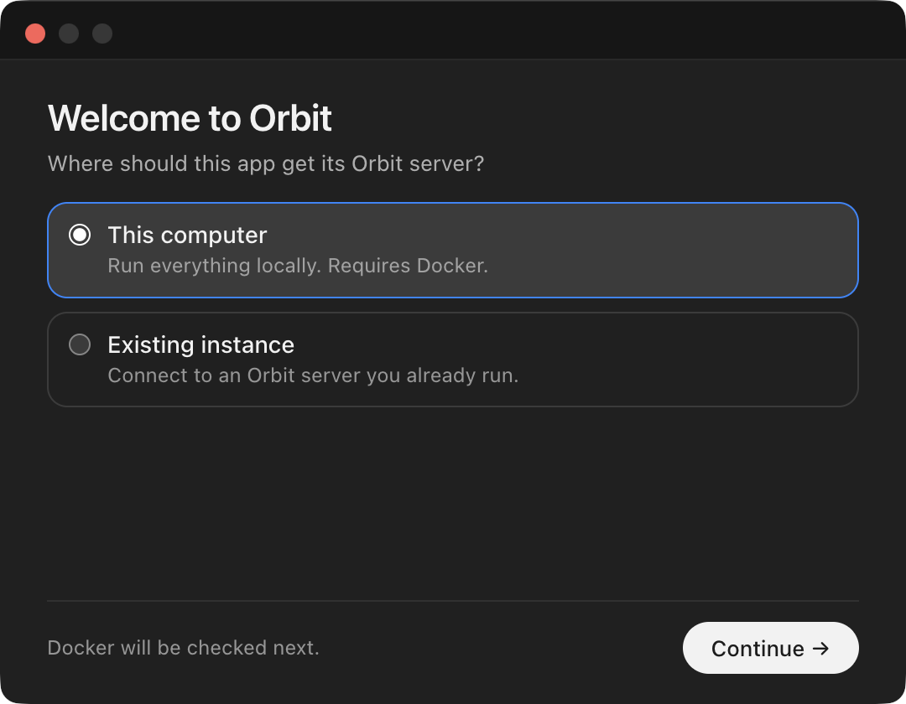

5. Orbit checks and installs what it needs, asking before each install:
   - **Hermes Agent**, the engine every bot runs on, if it is not installed.
   - **Docker Desktop**, if Docker is missing: Orbit downloads the right build for your Mac, checks Docker's signature, copies it to Applications and starts it. Accept Docker's licence when it asks, then click **Continue**.
   - **Apple's container runtime**, on Macs that use the native stack (macOS 26 or later with a release that ships the native server bundle). Orbit downloads Apple's signed package, checks its SHA-256 and signature, and macOS asks for your password to install it.

6. Orbit pulls its server image, starts the stack and signs you in. Your primary bot is ready when its Engine panel shows **Hermes · ready**.

   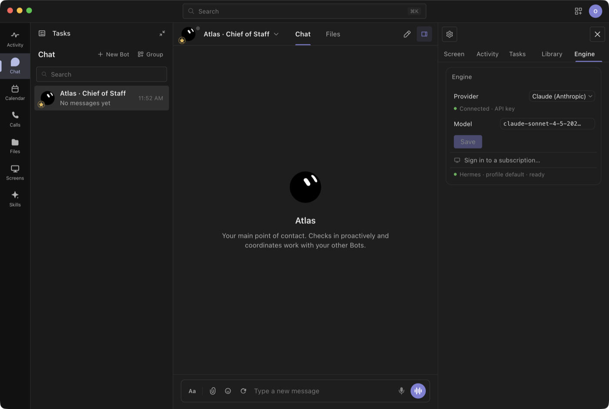

The screenshots above come from a real install of the unsigned Apple-silicon DMG, downloaded with the quarantine flag a browser sets, on macOS 26.

### Windows

Run `Orbit-Setup-<version>.exe`. If SmartScreen warns about an unrecognised app, choose **More info**, then **Run anyway**. When Docker is missing, Orbit can download and start Docker Desktop's installer, which handles elevation and WSL 2.

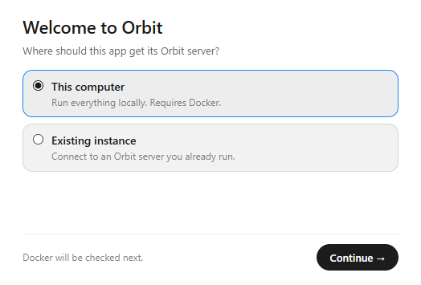

Choose **This computer**. Orbit starts its stack in Docker, signs you in and opens your primary bot. Its first answer comes from your Hermes agent:

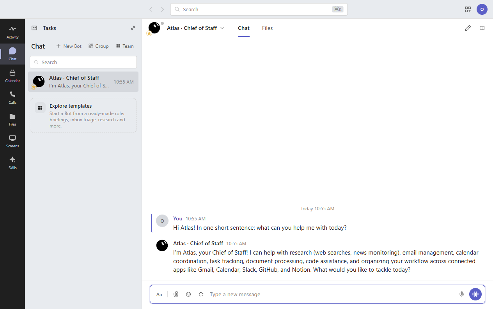

**GPU voice (optional, NVIDIA).** In a bot's details panel, open **Activity → Voice chat**, choose **GPU**, then **Install**. Orbit pulls the GPU voice server (about 4 GB) and restarts its api pointed at it. Then click **Download** for the models (about 5 GB; progress shows in place). Upload a portrait to get the animated avatar. **Remove** takes it away again.

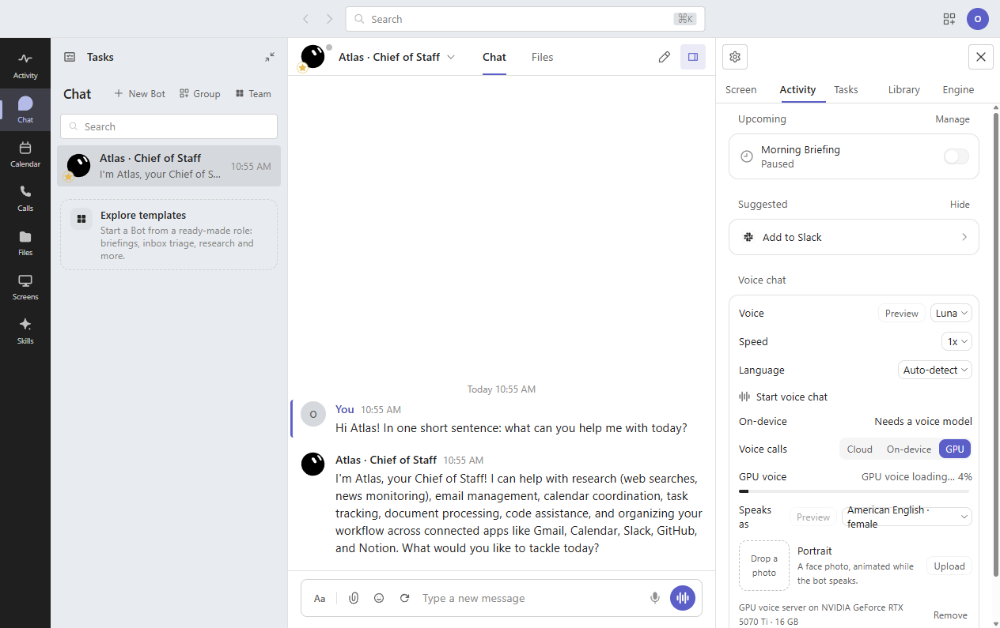

### Linux

Make the AppImage executable (`chmod +x Orbit-*.AppImage`) and run it. Install Docker Engine with your package manager first; Orbit does not install it on Linux. GPU voice works the same way as on Windows, and needs the NVIDIA driver and the [NVIDIA Container Toolkit](https://docs.nvidia.com/datacenter/cloud-native/container-toolkit/latest/install-guide.html):

```bash
sudo nvidia-ctk runtime configure --runtime=docker && sudo systemctl restart docker
docker run --rm --gpus all nvidia/cuda:12.8.1-base-ubuntu22.04 nvidia-smi   # should list your GPU
```

To build and try the AppImage from a Windows checkout, use `bash scripts/linux-installer-wsl.sh` (build), `… run` (launch under WSLg) or `… smoke` (the server's API smoke test on Linux).

### Voice on macOS

GPU voice is not offered on a Mac: there is no CUDA, and no Apple-silicon build of the sidecar yet. The desktop app turns it off (`AUDIOCPP_URL=off`), the GPU option is hidden, and calls use on-device speech recognition and TTS.

### After installing

Pick the model your agent runs on (see [Models and subscriptions](#models-and-subscriptions)). Claude through your existing Claude sign-in is the fastest path, and the one to use with GPU voice on an 8 GB card.

## Build and run

Requirements: **Node.js 22 or newer**, **pnpm 12** (the repo pins `packageManager`), Docker for the default desktop and per-bot computers, and Xcode or Android Studio only if you build the mobile app natively.

```bash
git clone https://github.com/raybello/orbit.git
cd orbit
pnpm install
cp .env.example .env       # fill in the keys; comments in the file explain each one
pnpm build                 # packages, web, server, desktop shell
pnpm test                  # server, web and desktop suites
pnpm typecheck             # all seven packages
```

`pnpm dev` runs the package dev tasks through turbo. For day-to-day work run the pieces you need:

```bash
pnpm --filter @orbit/server dev     # API on :8787, tsx watch
pnpm --filter @orbit/web dev        # Vite on :5173, proxies /api to GROKBOT_API or :8787
pnpm --filter @orbit/desktop dev    # build the Electron shell and launch it
pnpm --filter @orbit/mobile start   # Metro for the Expo client
```

The server serves `apps/web/dist` when it exists, so `pnpm --filter @orbit/web build` plus a server start gives you the production UI on the API port. The server needs a `SESSION_SECRET`; `DEV_LOGIN=1` enables the email-only sign-in form and must never be set on a public address.

Keys:

| Key | Used for |
|---|---|
| `SESSION_SECRET` | Sign-in sessions and the tokens agents use to reach `/mcp` |
| Nothing, `ANTHROPIC_API_KEY`, or another provider key | The model. Set in the primary Hermes home, not here; managed bots inherit it. A Claude subscription needs no key (see [Models and subscriptions](#models-and-subscriptions)) |
| `COMPOSIO_API_KEY` | Connected apps |
| `XAI_API_KEY` | Cloud voice and `x_search` (optional when local voice models are installed) |
| `ORGO_API_KEY`, `ORGO_COMPUTER_ID` | Orgo screens when `COMPUTER_KIND=orgo` |

A first run without `COMPOSIO_API_KEY` or `XAI_API_KEY` boots: both clients are lazy. Those features answer "not configured" until keys are present.

## Build per target

| Target | Dev | Production build | Output |
|---|---|---|---|
| **Web** | `pnpm --filter @orbit/web dev` | `pnpm --filter @orbit/web build` | `apps/web/dist` (static assets, served by the server or any static host) |
| **Server** | `pnpm --filter @orbit/server dev` | `pnpm --filter @orbit/server build` | `apps/server/dist`, started with `node --env-file=../../.env dist/index.js` from `apps/server` |
| **Desktop** | `pnpm --filter @orbit/desktop dev` | `pnpm --filter @orbit/desktop pack` | `apps/desktop/dist` (main, preload, setup) and electron-builder installers |
| **Mobile** | `pnpm --filter @orbit/mobile start` | `expo run:ios` / `expo run:android`, or an EAS build | Native app, or an `expo export` bundle |

**Web.** React 18, Vite and Zustand. Vite proxies `/api` to `GROKBOT_API` when set, otherwise `http://localhost:8787`. A build is a plain static bundle: no SSR, no server-side env. The API base is the origin that served the page, so a static host needs to proxy `/api` and `/api/events` to the server.

**Server.** TypeScript compiled with `tsc` to ESM in `apps/server/dist`. It owns the SQLite schema (created and upgraded in code, no migration runner), the Hono routers, the Hermes adapters, the SSE hub, MCP endpoints, VNC relays, the scheduler and the Docker provider. Signals are handled: `SIGTERM` stops relays and background work. `apps/server/Dockerfile` builds the API and the web bundle into one image; the same image runs `node dist/supervisor.js` as the second `sandbox-supervisor` service.

**Desktop.** An Electron 36 shell around the web renderer, built with esbuild (no hashing, source maps kept). `dev` builds the shell then launches Electron; `pack` builds the web app, the shell, checks bundled resources and runs electron-builder for the host platform. The shell starts or attaches to a local stack: Docker Compose by default, or a native server bundle on Apple Silicon macOS when the release ships one. `scripts/dev-rebuild-loop.sh` is the fast loop for server or web changes: it rebuilds the app image from this tree, recreates the compose stack and relaunches Electron. `scripts/dev-vite.sh` runs Vite against the running stack when only the UI changed.

**Mobile.** Expo SDK 53 and React Native 0.79, with expo-router file-based routes. Metro is the dev server; a native dev build is produced by `expo run:ios` or `expo run:android`, and release builds by the `eas.json` profiles. The API base is read from `EXPO_PUBLIC_API_URL` (baked into `extra.apiUrl` at build time) and can be changed at runtime on the server screen, where the token is stored in `expo-secure-store`. A release build must use `https`; the config throws rather than ship a cleartext public URL.

CI (`.github/workflows/ci.yml`) runs `pnpm install --frozen-lockfile`, typecheck, build, tests and the server smoke script on every push and pull request. `desktop-release.yml` publishes installers and the native server bundle on `v*` tags; `publish-images.yml` pushes the app and computer images for amd64 and arm64, and the GPU voice sidecar (`ghcr.io/raybello/orbit/audiocpp`, amd64), on `main` and tags.

### Build the installers

`scripts/build-installer.sh` builds an installer the way the release workflow does, without publishing. Output lands in `apps/desktop/out` with each file's size and SHA-256; builds are unsigned unless `CSC_LINK` is set.

```bash
bash scripts/build-installer.sh win      # NSIS .exe: on Windows locally, elsewhere on GitHub Actions
bash scripts/build-installer.sh mac      # DMG + zip for this Mac's chip (ARCH=all for both); GitHub Actions when not on a Mac
bash scripts/build-installer.sh linux    # AppImage, on Linux
bash scripts/linux-installer-wsl.sh      # AppImage from a Windows checkout, built inside WSL
bash scripts/linux-installer-wsl.sh run  # …and launch it under WSLg (also: smoke, test)
```

Try a build without touching your real install with `ORBIT_USER_DATA_DIR=<dir> ORBIT_STACK_DIR=<dir> ORBIT_IMAGE_TAG=edge`. `.vscode/launch.json` has a config for each of these under **orbit: installer —**.

## Run the Docker stack

`infra/compose` has two stacks. Both run `api` (port 8787, the API and the built web client) and `sandbox-supervisor` (no port; it suspends idle bot containers so they do not hold RAM after the API stops). State lives on the `orbit-data` volume: `DB_PATH=/data/orbit.db`, `ENGINES_DIR=/data/engines`, `COMPUTER_HOME_DIR=/data/computers`.

Source-based stack, builds the image from this checkout:

```bash
cp .env.example .env       # once, at the repo root; SESSION_SECRET is required
docker compose -f infra/compose/docker-compose.yml up --build
open http://127.0.0.1:8787
```

Image-based stack, what the desktop app bundles (`ghcr.io/raybello/orbit/app:<tag>`, `edge` tracks `main`):

```bash
cd infra/compose
cp .env.images.example .env    # fill in SESSION_SECRET (openssl rand -hex 32)
docker compose -f docker-compose.images.yml --env-file .env up -d
```

The build context for the server image is the repository root, not `apps/server`: the image installs the pnpm workspace. `docker build -f apps/server/Dockerfile -t ghcr.io/raybello/orbit/app:edge .` from the root builds the same thing.

Per-bot Docker computers need the host folder in `COMPUTER_HOME_DIR` to exist at the same absolute path inside the `api` container (the bot home is a host bind mount). Set `ORBIT_HOST_DATA` and mount it at the same path, or use `COMPUTER_KIND=orgo`.

To add GPU voice to the image stack, set `ORBIT_GPU_VOICE=1` and `AUDIOCPP_URL=http://audiocpp:8080` in its `.env` and add `--profile gpu` to the `up` command. The desktop app's **Install** button does exactly that.

## GPU voice from a checkout

Needs an NVIDIA GPU (Turing or newer, 8 GB or more with a cloud model) and Docker with GPU access: Docker Desktop on Windows has it, and Linux needs the NVIDIA Container Toolkit ([above](#linux)). `scripts/gpu-voice-stack.sh` covers each setup, and `.vscode/launch.json` has a config for each under **orbit: GPU voice —**.

```bash
bash scripts/gpu-voice-stack.sh            # the whole stack plus the sidecar (compose --profile gpu)
bash scripts/gpu-voice-stack.sh sidecar    # only the sidecar, for `pnpm --filter @orbit/server dev` on the host
NATIVE=1 bash scripts/gpu-voice-stack.sh   # the stack, pointed at an audiocpp_server already running on :8080
bash scripts/gpu-voice-stack.sh rebuild    # rebuild the sidecar from scratch; models are kept
bash scripts/gpu-voice-stack.sh logs       # or: down
```

The script compiles audio.cpp for your GPU only (about 10 minutes the first time). Then, in a bot's **Voice chat** settings, choose **GPU** and click **Download** for the models (about 5 GB). The server reads `AUDIOCPP_URL`: `http://127.0.0.1:8080` by default, and `off` disables GPU voice.

**Calls from a phone or another PC.** Browsers only give the microphone to `https://` pages (or `localhost`). The sidecar serves Orbit over HTTPS on port 8444 with its own certificate authority:

```bash
AUDIOCPP_TLS_HOSTS="localhost 127.0.0.1 192.168.1.20" AUDIOCPP_HTTPS_BIND=0.0.0.0 bash scripts/gpu-voice-stack.sh sidecar
```

Open `https://192.168.1.20:8444` (your LAN address) and accept the certificate warning once. More in the [setup guide](https://raybello.github.io/orbit/docs/setup.html#gpu-voice) and [docs/voice-audiocpp.md](docs/voice-audiocpp.md).

## Install on a remote computer

The app can run on the same computer as Hermes.

1. On your machine: `pnpm install && pnpm build` and package the server bundle, or use the release bundle. Copy the archive and `scripts/install-on-computer.sh` to the computer.
2. In Orgo, create a public URL for port `8787` on that computer.
3. On the computer, as root:

   ```bash
   PUBLIC_URL=https://<name>.orgo.dev ORGO_COMPUTER_ID=<uuid> ALLOWED_EMAILS=you@example.com \
   KEYS_FILE=/root/keys.txt PRIMARY_CDP_URL=http://127.0.0.1:9333 \
     bash install-on-computer.sh hq-app.tgz
   ```

   `KEYS_FILE` holds `XAI_API_KEY=` and `COMPOSIO_API_KEY=` lines (and `ORGO_API_KEY=` if Hermes' own `.env` has none); it is deleted after the first install. The script installs to `/opt/hq`, adds one supervisor program (`hq-app`), and leaves Hermes alone. Running it again with a newer archive upgrades the app and keeps its settings and data.
4. Give the main agent the app's tools: `python3 /opt/hq/app/scripts/add-hq-to-hermes.py`. It adds one `mcp_servers.hq` entry to Hermes' `config.yaml`, keeps a dated copy of the file, and Hermes picks the change up without a restart. `--remove` takes it out again.
5. Open the public URL and sign in with Google. If Google sign-in is not set up yet, `bash /opt/hq/app/scripts/sign-in-link.sh you@example.com` on the computer prints a one-time sign-in link.

## Models and subscriptions

The primary agent's model is set in Hermes (`hermes model`, or `hermes setup`), and new bots inherit it.

| Path | How | When |
|---|---|---|
| **Claude (recommended)** | `hermes model` → `anthropic` → `claude-sonnet-4-5`. If you are signed in to Claude Code, Hermes uses that sign-in; nothing else to do. Otherwise `hermes auth add anthropic`, or set `ANTHROPIC_API_KEY` in the Hermes home's `.env`. | The fastest responses, and the main path for GPU voice: about 2.3 s from the end of your sentence to the first spoken words, and the GPU only holds the voice models. |
| Other providers | `hermes model`, plus the provider's key or subscription sign-in. | Any model Hermes supports. |
| Local (LM Studio, Ollama…) | `provider: lmstudio` and `base_url: http://127.0.0.1:1234/v1` in Hermes' `config.yaml`; set `context_length` to what the model was loaded with (Hermes otherwise assumes 64K). | Fully offline. With GPU voice on the same card you need about 16 GB of VRAM, and the avatar arrives later. |

`hermes auth status anthropic` only reports logins Hermes stores itself, so it can say "logged out" while the Claude Code sign-in works. Hermes' home is `~/.hermes` on macOS and Linux, and `%LOCALAPPDATA%\hermes` on Windows.

To change a single bot, open its details panel, **Engine**. Pick a provider and model there. **Sign in to a subscription** opens a terminal on the bot's screen running Hermes' own sign-in for that provider (for example Claude Pro/Max), so you finish it in the viewer and the bot uses that subscription from then on. Check your provider's terms before running an agent on a consumer subscription.

A new managed bot inherits the primary agent's provider choice and API keys. Subscription tokens are inherited as access tokens, never as a copied refresh token; a Codex subscription needs its own sign-in because Hermes refuses a token store without a refresh token.

## Verification

The flows in the screenshots were run against a live stack on this branch:

| Flow | Evidence |
|---|---|
| Bot creation | `01-bot-creation.png`, `POST /api/bots`, `bot-service.test.ts`, `api-integration.test.ts` |
| New bot chatting | `13-mobile-thread.png`, the Iris thread in `07-voice-call.png`, `bot-lifecycle.test.ts` |
| New bot screens | `05-bot-screens.png`, `06-screen-viewer.png`, `computer-model.test.ts`, `computer-store-claim.test.ts` |
| Voice calling | `07-voice-call.png`, `voice-local-session.test.ts`, `voice-local.test.ts` |
| GPU voice + avatar (installed Windows app) | `gpu-voice/win-0*.png`, `voice-audiocpp.test.ts` (incl. live tests against the sidecar), `AudiocppVoice.test.tsx`, `gpu-voice.test.ts` |
| Group messages | `03-group-chat.png`, `rooms-cascade.test.ts` |
| Inter-bot communication | `04-inter-bot.png`, `rooms-cascade.test.ts` (mention dispatch, chain depth) |
| One-time and recurring events | `08-calendar-one-time.png`, `11-calendar-both.png`, `routines-calendar.test.ts` |
| Mobile | `12-mobile-bots.png`, `13-mobile-thread.png`, `14-mobile-calendar.png`, `15-mobile-computers.png` |

The voice screenshot is a real local call: a 16 kHz WAV prompt was fed through the browser's microphone input, the server transcribed it, Iris answered, and the call bar switched to Speaking. The mobile shots are an iPhone 17 Pro simulator running the Expo client against the same server.

## Status and limits

- Experimental, no security audit. Bots share a Docker host and can reach each other's files through their containers.
- Approval cards cover Composio write actions. What a bot does through its browser or shell is not gated, and Hermes' own "risky command" prompts are not shown in the app yet.
- The default ceiling is four bots (`MAX_BOTS=4`) because each Docker desktop takes a screen, a browser and roughly 1 to 2 GB of RAM. Raise it only on a host with the memory to match.
- A bot cannot use a Claude or ChatGPT subscription that the primary agent signed in to unless the provider allows token inheritance; Codex subscriptions always need their own sign-in.
- GPU voice needs an NVIDIA GPU on Windows or Linux. There is no Apple-silicon build of the sidecar yet, so Macs use on-device voice. The sidecar image is amd64 only.
- The desktop installers are not code-signed or notarized yet.
- The screen look is an original implementation inspired by OrgoAI/bops; no code or assets from that repository are used.

## License and credits

Project code is available under the [MIT license](LICENSE). The bot artwork and some icons come from Grok Bot's design and remain the property of their owners, as do third-party app logos; the MIT license does not cover them. See [third-party notices](THIRD_PARTY_NOTICES.md).

Built with [Hermes Agent](https://github.com/NousResearch/hermes-agent), [Composio](https://composio.dev), and optional [Orgo](https://orgo.ai) screens and [xAI](https://x.ai) voice. This is an independent project, unaffiliated with xAI, Cursor/Anysphere or Nous Research.
